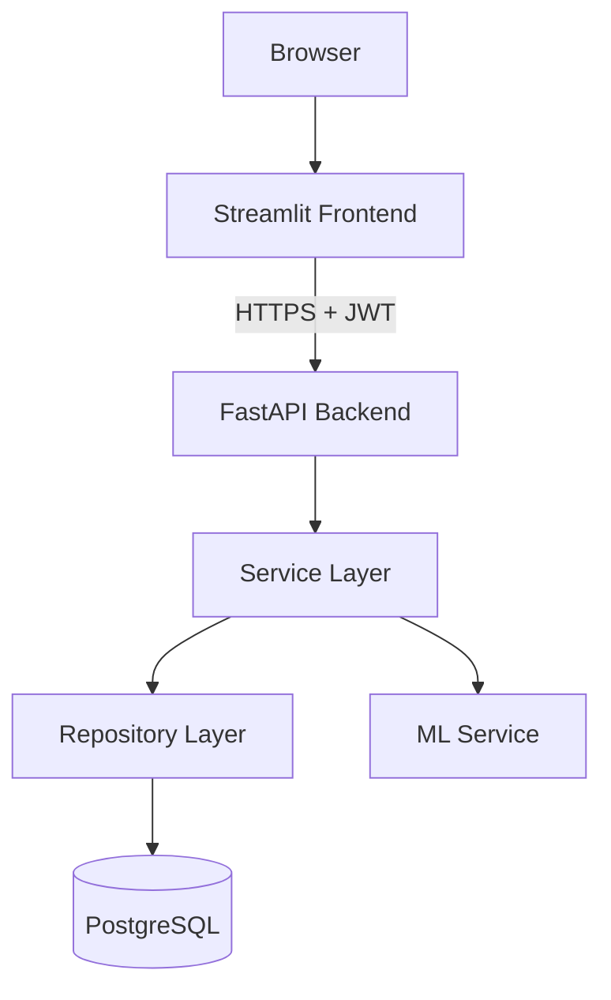

# 🛠️ Helpdesk-AI — Enterprise ITSM Assistant

> An intelligent IT Service Management (ITSM) platform powered by Machine Learning, inspired by ServiceNow's intelligent routing capabilities.

**Live demo:** [Frontend](https://helpdesk-ai-frontend-retv.onrender.com/) · [Backend API docs](https://helpdesk-ai-backend-0o3i.onrender.com/docs)
(Free-tier hosting — spins down after ~15 min idle, so the first request after that can take 30-60s to wake up.)

[](https://github.com/Shubhsinghal31/Intelligent-IT-Ticket-Routing/actions/workflows/ci.yml)
[](https://www.python.org/)
[](https://fastapi.tiangolo.com/)
[](https://streamlit.io/)
[](https://www.postgresql.org/)
[](https://www.docker.com/)
[](LICENSE)

---

## 📌 Overview

**Helpdesk-AI** is a full-stack, AI-powered IT helpdesk system that automates:
- 🎯 **Priority prediction** for incoming tickets
- 🏢 **Department auto-assignment** based on ticket content
- ⏱️ **SLA breach prediction** to flag at-risk tickets
- 📊 **Real-time analytics dashboards** for admins

## 🏗️ Architecture

Full diagrams (Mermaid, render natively on GitHub) live in
[`docs/architecture/`](docs/architecture/):

- [`system-architecture.md`](docs/architecture/system-architecture.md) —
  component diagram, layered clean-architecture explanation, deployment
  topology
- [`er-diagram.md`](docs/architecture/er-diagram.md) — full entity-relationship
  diagram (all 9 tables)
- [`sequence-diagrams.md`](docs/architecture/sequence-diagrams.md) — login,
  ticket creation with ML, and the assign->resolve lifecycle



## 🚀 Tech Stack

| Layer | Technology |
|---|---|
| Frontend | Streamlit |
| Backend | FastAPI |
| Database | PostgreSQL |
| ML | Scikit-learn |
| Auth | JWT |
| Visualization | Plotly |
| Containerization | Docker |
| CI/CD | GitHub Actions |
| Deployment | Render |

## 📂 Project Structure

```
helpdesk-ai/
├── backend/           # FastAPI app (clean architecture layers)
│   ├── api/           # HTTP routes
│   ├── services/      # Business logic
│   ├── repositories/  # DB access
│   ├── models/        # SQLAlchemy ORM
│   ├── schemas/       # Pydantic DTOs
│   ├── core/          # Config, security, DB
│   └── utils/         # Helpers
├── frontend/          # Streamlit UI
├── database/          # Migrations + seeds
├── ml/                # ML training + models
├── tests/             # Unit + integration tests
├── docs/              # Architecture + API docs
├── docker/            # Dockerfiles
└── .github/           # CI/CD workflows
```

## 🛠️ Local Setup

```powershell
# Clone the repo
git clone https://github.com/Shubhsinghal31/Intelligent-IT-Ticket-Routing.git
cd Intelligent-IT-Ticket-Routing

# Create virtual environment
python -m venv .venv
.\.venv\Scripts\Activate.ps1

# Install dependencies
pip install -r requirements.txt

# Configure environment -- copy the template and fill in real values
# (JWT_SECRET_KEY especially: must not be the placeholder, see
# backend/core/config.py's validator)
copy .env.example .env

# Apply the database schema
alembic upgrade head

# Run the backend (Swagger UI at http://localhost:8000/docs)
uvicorn backend.main:app --reload

# In a second terminal -- run the frontend
streamlit run frontend/Home.py
```

**Running the test suite:**

```powershell
docker compose -f docker/docker-compose.test.yml up -d
pytest tests -v
```

## 🐳 Running with Docker

The whole app — Postgres, backend, and frontend — can run as containers
instead of a `.venv`. Run from the **repo root** (not from inside `docker/`):

```powershell
docker compose -f docker/docker-compose.yml up --build
```

- Backend (Swagger UI): http://localhost:8000/docs
- Frontend: http://localhost:8501

The backend container bootstraps its own database on startup (schema +
seed data — see `database/bootstrap.py`), so there's no manual `alembic`/
`psql` step to run first. It reuses your `.env` for everything except
database credentials, which are fixed, Docker-only values decoupled from
your native Postgres setup (see `docker/docker-compose.yml`'s header
comment for why).

```powershell
docker compose -f docker/docker-compose.yml down       # stop
docker compose -f docker/docker-compose.yml down -v    # stop + wipe the container DB
```

This is separate from `docker-compose.test.yml` above, which only runs a
throwaway Postgres for the test suite — see `docs/interview/13-dockerization.md`
for why those are two different files.

## 📍 Roadmap

- [x] **Milestone 0** -- Project foundation & folder structure
- [x] **Milestone 1** -- Database design (ER diagram + schema)
- [x] **Milestone 2** -- FastAPI backend skeleton
- [x] **Milestone 3** -- JWT authentication & role-based access
- [x] **Milestone 4** -- Ticket CRUD APIs, comments, lifecycle state machine
- [x] **Milestone 5** -- ML models (priority, department, SLA breach, resolution time)
- [x] **Milestone 6** -- ML integration with ticket creation
- [x] **Milestone 7** -- Streamlit user frontend (login, tickets, ticket detail)
- [x] **Milestone 8** -- Streamlit admin dashboard, user management, SLA policies, heatmap
- [x] **Milestone 9** -- Reports (Excel/CSV/PDF export)
- [x] **Milestone 10** -- Logging, structured error handling, rate limiting
- [x] **Milestone 11** -- Unit + integration test suite (134 unit, 57 integration)
- [x] **Gap fill** -- Forgot Password flow (JWT-adjacent, hashed single-use tokens)
- [x] **Gap fill** -- Ticket attachments (upload/list/download, local disk storage)
- [x] **Gap fill** -- Ticket history / audit trail
- [x] **Gap fill** -- Architecture, ER, and sequence diagrams
- [x] **Milestone 12** -- Dockerization
- [x] **Milestone 13** -- CI/CD with GitHub Actions (lint + full test suite on every push)
- [x] **Milestone 14** -- Deployment on Render (Blueprint: managed Postgres + two Docker web services)
- [x] **Milestone 15** -- Portfolio prep (screenshots, demo script, resume bullets, STAR stories)

## 🎬 Portfolio Materials

- [Demo script](docs/portfolio/demo-script.md) -- a spoken walkthrough for a
  video or live interview demo
- [Resume bullet points](docs/portfolio/resume-bullets.md) -- several
  variants at different lengths
- [STAR interview stories](docs/portfolio/star-stories.md) -- four stories
  grounded in real debugging that happened on this project (CI failures,
  Render deployment issues, RBAC design)
- [Interview prep, by milestone](docs/interview/) -- one doc per milestone,
  Q&A format
- Screenshots: `docs/screenshots/` (see checklist below -- most require
  being logged in, which has to be captured by hand)

### Screenshot checklist

A few are already in `docs/screenshots/milestone-2/` (Swagger UI, terminal,
project tree in VS Code). Still missing -- capture these from the live app
or local run and drop them in a new `docs/screenshots/milestone-15/` folder:

- [ ] Login page
- [ ] Create Ticket form, filled in
- [ ] Ticket detail page showing the ML-predicted priority/department/SLA
- [ ] Admin dashboard (open/closed counts, resolution time, monthly trend)
- [ ] Department x priority heatmap
- [ ] Reports page mid-export (Excel/CSV/PDF)
- [ ] Swagger UI (`/docs`) on the *live* Render URL, not just localhost

## 👤 Author

**Shubh Singhal**
- GitHub: [@Shubhsinghal31](https://github.com/Shubhsinghal31)
- LinkedIn: [Shubh Singhal](https://linkedin.com/in/shubh-singhal)

## 📜 License

MIT License -- see [LICENSE](LICENSE) for details.
