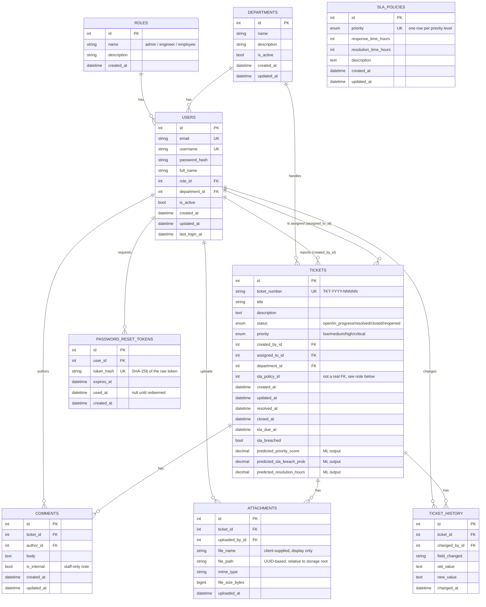

# Entity-Relationship Diagram

Supersedes `docs/architecture/er_diagram.png` (Milestone 1 draft), which
predates the `comments.user_id → author_id` / `comments.content → body`
rename and the `password_reset_tokens` table added later. This file is now
the source of truth — kept in Mermaid so it lives in version control and
updates in the same PR as the migration that changes the schema, rather
than needing a separate diagramming tool to regenerate a PNG.

## Notes worth knowing

- **`tickets.sla_policy_id` is currently unused.** `TicketService.create_ticket()`
  looks up the applicable `SlaPolicy` by matching `SlaPolicy.priority ==
  ticket.priority.value` at creation time — it never writes
  `ticket.sla_policy_id`. The column exists in the schema but nothing
  populates it, and the model doesn't even declare it as a real
  `ForeignKey`. Flagging this here rather than quietly fixing it: it's a
  reasonable simplification (SLA policies are looked up by priority, not
  a specific policy version, so there's no "which policy applied"
  ambiguity to resolve) but it is schema debt worth a deliberate decision
  — either wire it up for historical accuracy (a policy's hours could
  change after a ticket was created) or drop the column.
- **Cascade rules**: `ticket_id` foreign keys are all `ON DELETE CASCADE`
  (deleting a ticket deletes its comments/attachments/history — there's no
  ticket delete endpoint today, but the schema is ready for one).
  `changed_by_id` / `author_id` / `uploaded_by_id` are `ON DELETE
  RESTRICT` — you cannot delete a user who has ever authored a comment,
  uploaded a file, or changed a ticket, which is exactly what you want for
  audit integrity.
