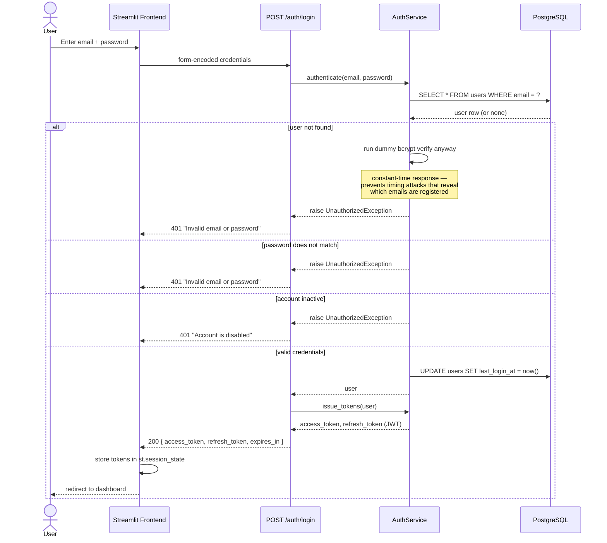
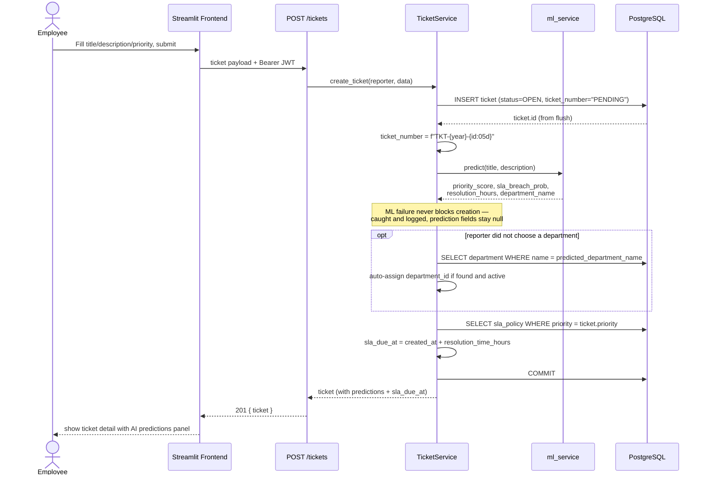
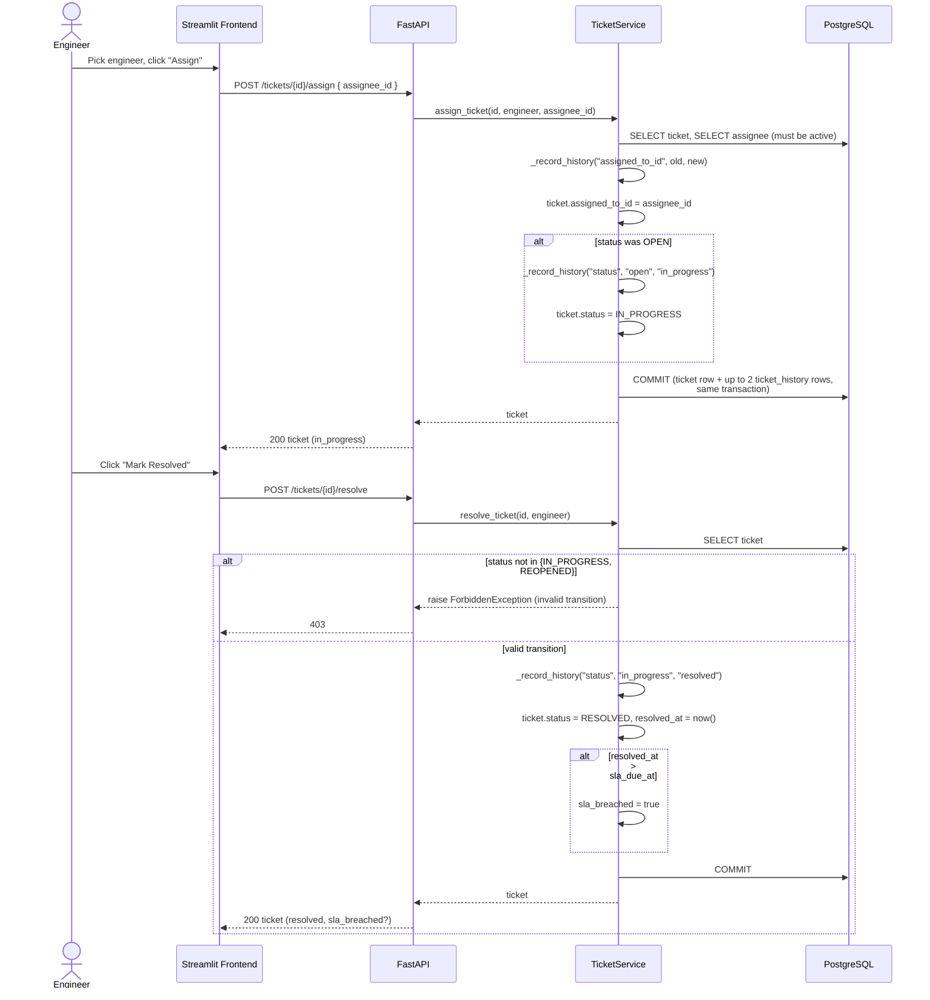

# Sequence Diagrams

Three flows chosen to cover the system's most interesting behavior: auth
(security-critical), ticket creation (ML integration), and the lifecycle
transitions (state machine + audit trail interaction).

## 1. Login

## 2. Create ticket (with ML prediction + SLA due date)

## 3. Assign → resolve (state machine + audit trail)

**Why the assign step matters for the audit trail design:** two
`ticket_history` rows can be written inside the *same* commit (assignee +
status). Postgres's `CURRENT_TIMESTAMP` default is transaction-time, so
both rows get an identical `changed_at` — `TicketHistoryRepository`
breaks that tie with `id` as a secondary sort key, not timestamp alone.
See the repository docstring for the full explanation; this bit an
integration test before it was caught.
