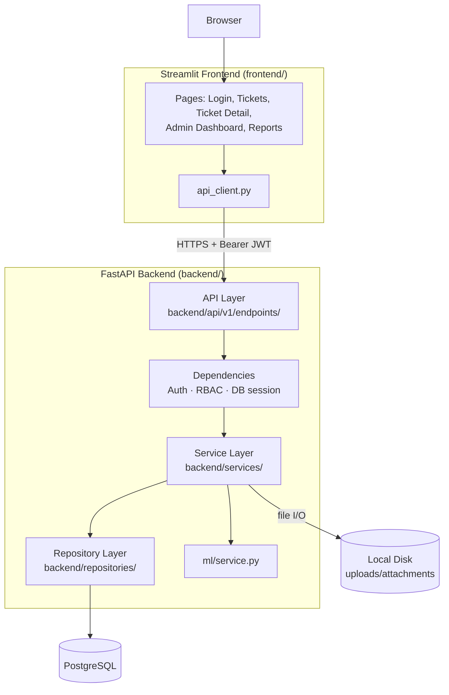
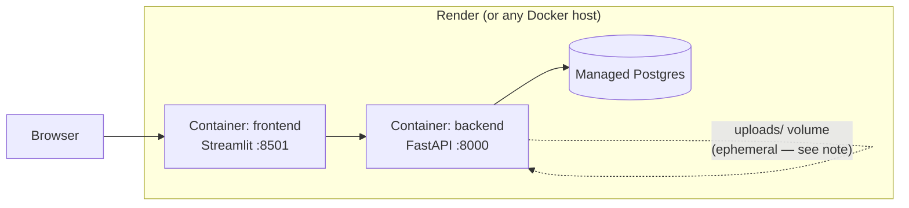

# System Architecture

## Component overview

Three deployable pieces talk over HTTP: the Streamlit frontend never touches
the database directly, and the FastAPI backend never renders UI. That
separation is what lets each one be redeployed, scaled, or replaced
independently.

## Why a layered backend

`backend/` follows the same rule at every level: **each layer only talks to
the layer directly below it.**

- **API layer** (`api/v1/endpoints/`) — thin route handlers. Parse the
  request, call one service method, return its result. No business logic,
  no SQL.
- **Dependency layer** (`api/deps.py`) — FastAPI `Depends()` functions:
  who is the current user, do they have the right role, give me a DB
  session. Shared across every endpoint instead of repeated in each one.
- **Service layer** (`services/`) — all business rules live here: RBAC
  checks, ticket state-machine transitions, SLA math, ML orchestration,
  audit-trail writes. This is the layer unit tests exercise, mocking the
  repository so no database is needed (see `tests/unit/`).
- **Repository layer** (`repositories/`) — the only code that writes
  SQLAlchemy queries. Services never import `select()` directly; they call
  `self.ticket_repo.get_by_id(...)`. This is what makes swapping storage
  details (an index, a join strategy, eventually even a different DB)
  a repository-only change.
- **Models** (`models/`) — SQLAlchemy ORM classes, one per table, no
  business logic beyond simple computed properties (e.g.
  `PasswordResetToken.is_valid`).

This is the Dependency Inversion half of SOLID in practice: a service
depends on a repository's *method names*, not on how those methods query
Postgres. `TicketService.assign_ticket()` doesn't know or care whether
`TicketRepository.get_by_id()` uses a `joinedload` or three separate
queries — that's exactly the point.

## Deployment topology (Milestone 12–14 target)

**Known limitation, documented on purpose:** ticket attachments are stored
on local disk (`ATTACHMENTS_STORAGE_PATH` in `backend/core/config.py`).
Render's filesystem is wiped on every redeploy, so uploaded files won't
survive a deploy in production as-is. `Attachment.file_path` is stored
*relative* to the storage root specifically so this is a one-file change
(`AttachmentService`) to an S3-compatible bucket later — tracked for
Milestone 14.
